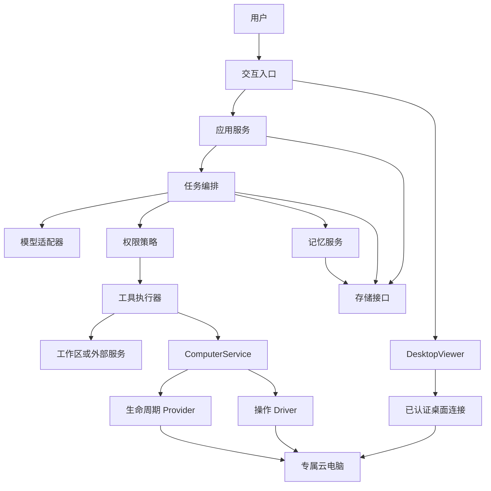
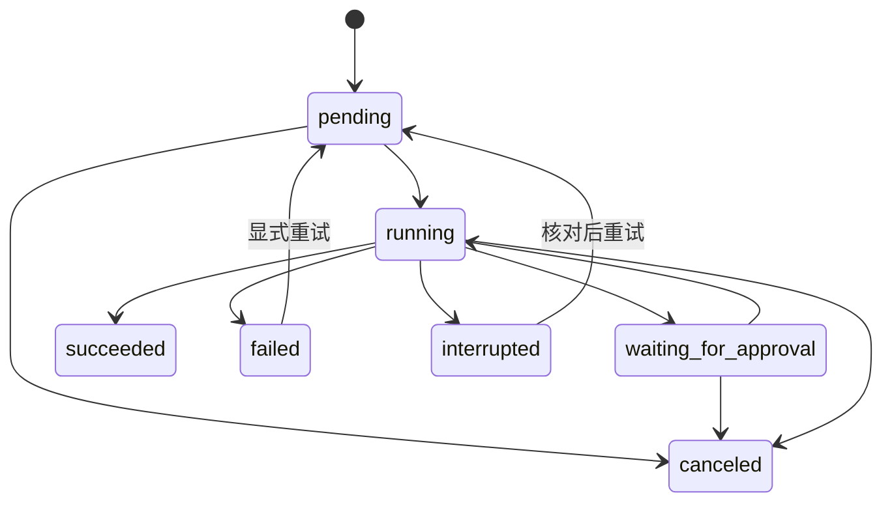

# 系统架构

状态：Sydney 的目标架构约束。已接受 [ADR-0003](adr/0003-rakazo-fork-as-execution-base.md)，使用独立 Rakazo 代码副本验证执行底座。下述模块名是逻辑职责，不表示上游存在同名实现或 Sydney 已通过验收。

底座试点先沿用上游 `apps/web`、`apps/api`、`apps/worker`、`packages/core`、`packages/adapters`、`packages/adapter-kit` 和 `packages/db`。Pi 在控制侧运行，Linux 桌面由 `SandboxProvider` 接入；`ComputerService`、Provider / Driver 分离及接管规则仍是需要对照源码验证的 Sydney 目标，暂不新建平行执行框架。

## 1. 架构方向

控制服务采用模块化单体，使用 TypeScript 实现任务编排、模型适配、权限和数据访问。按 [ADR-0004](adr/0004-native-server-and-task-orchestration.md)，首版后台和桌面位于同一台 Linux 服务器，使用不同账号及受控通信，通过统一 Provider 接口接入。下图中的客体表示逻辑执行面，不要求独立 VM 或 Docker。

PC 前端暂按浏览器工作台规划。控制服务可以在本机或云端部署，任务与记忆保存在控制侧，电脑内的文件独立管理。若使用远程模型，实际发送内容必须符合 [安全与隐私](security.md)。

模型和工具返回值都进入任务编排层处理。模型生成的工具调用提案必须经过参数校验和权限检查才能执行。

## 2. 模块职责

| 模块 | 负责 | 边界 |
| --- | --- | --- |
| 交互入口 | 输入、结果展示、确认请求、取消操作 | 不直接调用模型、工具或数据库 |
| 应用服务 | 用例入口、任务查询、配置加载 | 不耦合具体界面框架 |
| 任务编排 | 执行循环、状态迁移、超时、取消、重试 | 不保存供应商 SDK 特有对象 |
| 模型适配器 | 统一消息、工具声明、响应、用量和错误 | 不直接执行工具或授予权限 |
| 权限策略 | 判断授权范围、有效期和风险类别 | 不接受工具输出授予的新权限 |
| 工具执行器 | 校验参数、执行、结果归一化、记录副作用 | 不绕过权限策略 |
| 记忆服务 | 显式保存、更新、检索和删除记忆 | 不把所有聊天自动变成长期记忆 |
| 存储接口 | 任务、步骤、授权、记忆的持久化 | 不承载模型决策逻辑 |
| ComputerService | 电脑绑定、能力检查、会话租约、接管、急停 | Agent 和界面不接触供应商密钥 |
| ComputerProvider | 接入、状态和可选的资源生命周期管理 | 不将供应商对象暴露给业务层 |
| ComputerDriver | 截图、输入、文件、终端等客体操作 | 不持有云账号管理凭据 |
| DesktopViewer | 内嵌画面、控制权和连接状态展示 | 通过短期会话连接，不能自行授予控制权 |

通过构造参数传入模型、存储、工具和时钟等依赖，便于测试替换。控制侧不拆分微服务，不引入消息队列或独立向量数据库；客体内如需常驻驱动，它属于执行面。

详细接口和替换语义见 [云电脑接入设计](cloud-computer.md)，资源见 [基础设施清单](infrastructure.md)，界面见 [PC 界面规划](frontend.md)。

## 3. 核心数据

下表保留产品逻辑字段，不作为创建新表的指令。实现映射以 [Task / Run 设计](../docx/design/TASK_RUN_MAPPING.md) 为准：优先使用上游 Task、Run、Attempt、ExternalEffect、Event 和 Ticket；首轮不增加平行任务数据库。P2 纯策略返回执行意图，不自行保存状态或持有租约。

P2 已补 [只读状态投影与历史适配](../docx/design/TASK_PROJECTION.md)。展示状态与现有数据库兼容状态分开；读取采用匹配租户及单事务一致快照，默认不读取敏感载荷。当前仍无 API 或执行器接线，不能把这些模块描述为已可运行的 Sydney 任务闭环。

| 实体 | 最小字段 |
| --- | --- |
| Task | id、input、status、created_at、updated_at、started_at、finished_at、result、error、attempt_count |
| Step | id、task_id、sequence、kind、status、started_at、finished_at、result_summary、error |
| ToolCall | id、step_id、tool_name、validated_arguments、authorization_id、status、effect_status、idempotency_key、result_summary |
| Authorization | id、task_id、tool_name、resource_scope、action_scope、expires_at、revoked_at |
| Memory | id、content、source_task_id、created_at、updated_at |
| Computer | id、provider_id、external_id、status、capabilities、persistence、expires_at |
| ComputerSession | id、computer_id、generation、controller、lease_expires_at、viewport_version |

敏感参数和完整工具内容不默认写入普通执行日志；持久化字段的脱敏、必要性和访问方式在实现时按场景确定。时间持久化使用 UTC，展示时使用用户配置时区。

使用云电脑的任务和步骤额外绑定 `computer_id` 与会话代次，切换电脑不自动改变进行中任务的目标。

工具执行状态与副作用状态分开记录：`effect_status` 至少区分无副作用、已确认完成和结果未知。网络超时不能直接解释为“操作没有发生”。

消息、任务记录和长期记忆分别管理；删除记忆不会自动删除引用该信息的旧任务记录，界面和文档应明确删除范围。

## 4. 执行流程

1. 校验输入和配置，持久化任务，进入队列。
2. 取出任务并标记执行中，装配相关上下文和用户允许使用的记忆。
3. 调用模型，获得回答或工具调用提案；检查执行预算。
4. 校验工具名、参数、资源范围和有效授权。
5. 授权不足时保存待确认请求，暂停任务；用户确认后继续，拒绝或过期则取消。
6. 执行工具，持久化结构化结果和已发生的副作用，必要时继续下一步。
7. 根据实际工具结果生成最终答复，保存结束状态。

授权通过界面或可信应用入口提交，不通过模型文本或工具返回值提交。确认内容变化时重新校验授权，不能使用旧确认执行不同操作。

## 5. 状态与恢复

| 状态 | 含义 |
| --- | --- |
| pending | 已持久化，等待执行 |
| running | 正在调用模型或执行步骤 |
| waiting_for_approval | 已保存待确认操作，等待用户处理 |
| succeeded | 满足任务完成标准，结果已保存 |
| failed | 明确失败，错误已保存 |
| canceled | 用户取消、授权拒绝或授权过期 |
| interrupted | 进程中断或操作结果不确定，需要核对 |

重启后将遗留的 `running` 任务转为 `interrupted`；`waiting_for_approval` 保持等待，校验授权期限。重试保留原步骤和尝试次数，不能覆盖历史。

取消执行中的任务时停止安排后续步骤，并尽力中止当前调用。无法立即中止时先返回“取消请求已接收”；当前调用结束后记录真实结果，再进入 `canceled`。无法确定副作用时进入 `interrupted`，不得误报回滚成功。

## 6. 接口约束

- 模型适配器返回统一的回答、工具调用提案、用量和错误对象。
- 工具声明名称、输入结构、资源范围、风险类别、超时、是否支持幂等和取消。
- 工具结果包含执行状态、供模型使用的内容、供用户核对的摘要和副作用状态。
- 存储接口支持按任务编号读取历史，以及原子保存状态与对应执行记录。
- 未知模型响应、非法工具参数或超出预算的调用不得进入执行器。

## 7. 当前不做

不在没有实际需求时增加复杂的智能体规划框架、事件总线、分布式事务或自动记忆推断。扩展方案必须说明当前约束、收益及迁移成本，并记录 ADR。
