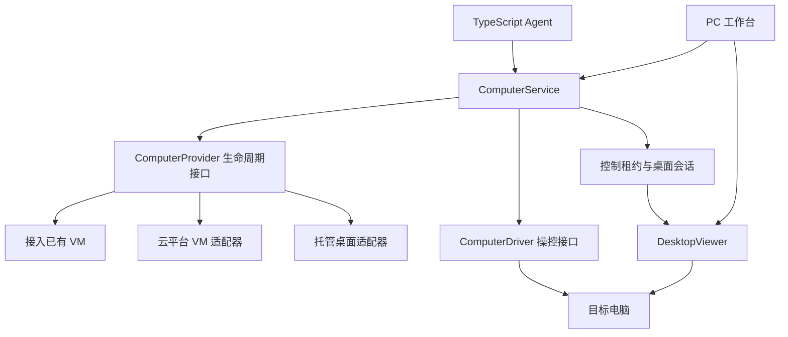

# 可插拔云电脑设计

状态：接口与接入方案提议，尚未实现。更新日期：2026-11-03。

后续决策：按 [ADR-0004](adr/0004-native-server-and-task-orchestration.md)，首版后台与 Agent 桌面在同一台专属 Linux 服务器原生运行。具体复用点、生产限制及待验证能力见 [原生 Linux 设计](../docx/design/NATIVE_LINUX_DESIGN.md)。本文件保留可插拔目标契约；不要求新建平行 Provider 框架，不以 Docker 先行，也不将现有开发用 `desktop` 直接当作生产图形桌面。

关联需求：PA-011 至 PA-017。

## 1. 目标与“可插拔”的含义

Agent 使用同一组电脑工具，PC 工作台使用同一个桌面容器，通过配置选择电脑来源，不在业务代码里绑定某个供应商。

支持方向包括接入已有云虚拟机、自行管理云虚拟机生命周期，以及托管桌面沙箱。第一版实现一个真实 Provider 和一个测试替身，第二个真实 Provider 在需要时接入。

“可插拔”表示协议和能力可替换，不表示更换供应商后原电脑的内存、文件、登录态、系统镜像和账单自动迁移。

## 2. 分层

### ComputerService

业务层的唯一入口。校验权限和能力，绑定任务与电脑，管理输入租约、接管、急停、会话代次和审计。模型只能请求电脑动作，不能获取供应商 API 密钥。

### ComputerProvider

负责接入、检查状态、断开，以及可选的创建、启动、停止和销毁。接入一台已有电脑的 Provider 可以不具备任何云资源管理权限。

### ComputerDriver

负责截图、鼠标、键盘、文件和终端。Provider 可以使用自建客体代理或封装供应商的电脑操控 API，业务层接收统一结果。

### DesktopViewer

负责人工观看和接管。按返回的会话类型使用 noVNC、Guacamole 或供应商允许的嵌入方式；不假定所有供应商都提供同一种流协议。

noVNC 是基于 WebSocket 的 VNC 客户端；Guacamole 提供浏览器中的 VNC/RDP 等远程桌面接入。[S1][S2] 两者承担画面和交互连接，不能独自提供云资源生命周期、完整文件终端 API 或 Agent 任务管理。

## 3. 最小契约

以下为 TypeScript 包需要定义的契约，字段和签名在工程初始化时落实。

| 契约 | 最小操作或字段 |
| --- | --- |
| ComputerRef | 内部 computerId、providerId、供应商 externalId |
| ComputerCapabilities | 客体操作系统、可用动作、管理员能力、持久性、到期时间、能力版本 |
| ComputerProvider | attach、inspect、disconnect；可选 lifecycle 管理器 |
| ComputerLifecycle | create、start、stop、destroy，分别声明是否支持 |
| ComputerDriver | screenshot、click、move、scroll、drag、typeText、pressKeys、exec、readFile、writeFile |
| ComputerSession | 会话编号、电脑编号、代次、控制者、租约期限、显示器与视口信息 |
| ViewerSession | 连接类型、短期连接描述、到期时间、只读或可控制模式 |
| ComputerActionResult | actionId、computerId、是否成功、结果摘要、副作用状态、错误类别 |

截图返回真实尺寸、显示器编号、采集时间和视口版本。点击坐标基于对应截图的客体像素，不能直接使用缩放后的 CSS 坐标。

终端执行返回命令编号、退出码、截断后的标准输出和错误输出；长任务支持查询和取消。文件传输限制单次大小，不把大文件作为模型消息传递。

## 4. 能力声明

能力在实际电脑和会话层判断，而非仅根据供应商品牌判断。

| 能力 | 用途 |
| --- | --- |
| desktop.view / desktop.input | 查看和操作桌面 |
| shell.exec | 在客体内执行命令 |
| files.read / files.write | 读写客体文件 |
| privilege.admin | 是否具有本任务所需的客体管理员能力 |
| lifecycle.create / start / stop / destroy | 云资源管理 |
| snapshot.create / snapshot.restore | 创建及恢复快照 |
| persistence.disk | 文件是否跨停止、过期或重建保留，需附具体语义 |

不支持的操作返回 `CAPABILITY_UNSUPPORTED`，界面明确说明原因。不能把不支持的“关机”自动替换为“销毁”，也不能把“断开连接”显示为“停止计费”。

能力名称相同不代表语义一致：普通停机、沙箱暂停、内存休眠和磁盘快照分别记录，不做伪统一。

## 5. 接入方案比较

| 方案 | 适用情况 | 项目需要实现 | 主要限制 |
| --- | --- | --- | --- |
| BringYourOwnProvider | 已有或准备购买一台专属云电脑 | 客体驱动、可信连接、桌面入口、健康检查 | 初版可不支持自动创建和停止实例 |
| ManagedVmProvider | 需要自建的完整系统与资源控制 | 供应商生命周期适配、镜像、磁盘、网络和恢复 | 运维工作较多，不同云平台分别适配 |
| E2BDesktopProvider | 希望快速验证托管电脑操控 | 适配 Desktop SDK、会话、持久性和限额 | 客体权限、保留期限及计划限制需验证 |
| DaytonaProvider | 需要托管沙箱与桌面、终端等集成 | 适配所选稳定 SDK 与桌面会话 | 所选版本、平台能力和地区需验证 |

E2B 的官方 Desktop 项目提供桌面环境及 JavaScript/TypeScript 接入。[S3] Daytona 官方文档提供 TypeScript 的 Computer Use 接口，并区分人工 VNC 与程序化桌面操控。[S4]

以上事实不等同于完成本项目适配，不能据此宣称两个 Provider 的权限、持久性、快照和价格相同。

### 当前建议

ADR-0003 之后先验证上游 Docker Linux 电脑与现有测试替身，再核对权限、接管和恢复差距。生产环境优先考虑专属 Linux 执行环境；已有 VM 接入或托管 Provider 的具体选择需通过试验确定，不从 Docker 本机可运行推导出任意云主机可直接接入。

第二个 Provider 从 E2B Desktop 或 Daytona 中择一，通过接入试验决定。长期资源管理需要明确后，再将所用云平台的创建、启停和快照作为 ManagedVmProvider 的能力实现。

若优先级变为最快演示、暂时不要求完整系统权限，可以把托管 Provider 调整为首个实现；接口分层保持一致。

## 6. 接管与并发

- 同一桌面同一时刻仅有一个输入控制者，取值为 Agent、人工或无。
- 用户接管前撤销 Agent 输入租约，再开放人工输入；只改前端显示不足以完成接管。
- 交还后 Agent 重新截图和观察，不能继续执行接管前缓存的坐标动作。
- 同一电脑上的终端和文件写入也纳入任务租约，防止“停了鼠标，终端还在修改文件”。
- 接管先阻断新操作；正在执行的命令尽力取消，并在界面显示残留进程或未结束的动作。
- 界面关闭不自动取消已提交任务；任务由控制服务继续运行，并受预算和超时约束。

阻断本服务的新输入不等于停止客体内所有进程。只有具备独立于客体的停机或隔离通道，才能提供整机级急停；仅接入已有电脑时必须明确显示该能力是否可用。

## 7. 替换、断开和释放

替换流程：

1. 暂停任务并阻断新动作，等待或核对进行中的操作。
2. 保存旧电脑标识、必要文件和当前任务记录。
3. 撤销旧会话与租约，增加会话代次。
4. 接入新电脑，检查能力、授权、网络及显示器信息。
5. 用户选择从明确检查点继续或重新执行，不自动重放旧输入。
6. 单独处理旧电脑的保留或销毁，返回对应账单提示。

停止和切换服务端对旧请求做代次检查，不能只依赖客户端主动断开。

跨供应商只承诺用户选择的普通文件导出和导入方案；不默认迁移系统盘、进程内存、浏览器 Cookie 或凭据。

## 8. 错误与执行记录

至少区分：`COMPUTER_UNAVAILABLE`、`CAPABILITY_UNSUPPORTED`、`SESSION_EXPIRED`、`CONTROL_LEASE_LOST`、`AUTHORIZATION_DENIED`、`RESOURCE_LIMIT`、`ACTION_TIMEOUT` 和 `EFFECT_UNKNOWN`。

对无法确认是否已发生的点击、键入、上传和命令，不因超时自动重试。重新观察电脑和外部结果，再决定继续方式。

## 9. 接入验收

- 同一工具动作和错误结构适用于首个真实 Provider 与测试替身。
- Agent 核心和 PC 组件没有供应商 SDK 导入。
- 能力不足时不执行替代性的危险动作。
- 人工接管、会话过期、断网和换机后，旧动作无法继续输入。
- 文档说明断开、停止和销毁对数据与费用的不同影响。
- 电脑内有管理员权限时，控制服务和云账号凭据仍留在客体外。

## 10. 核实来源

核实日期：2026-11-03。选型时再次确认实际版本、地域、权限和计费。

- [S1] noVNC API：`https://novnc.com/noVNC/docs/API.html`
- [S2] Apache Guacamole 官方介绍：`https://guacamole.apache.org/doc/gug/introduction.html`
- [S3] E2B Desktop 官方仓库：`https://github.com/e2b-dev/desktop`
- [S4] Daytona Computer Use：`https://www.daytona.io/docs/en/computer-use/`
