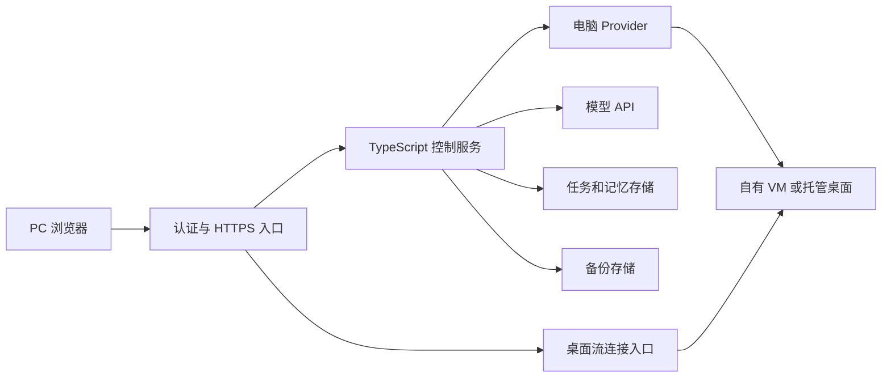

# 服务器与基础设施清单

状态：单用户、同时运行一台电脑的配置建议，尚未采购或部署。更新日期：2026-11-03。

本清单按 PC 客户端、TypeScript 控制服务、可插拔云电脑设计。下列硬件规格是首轮工程预算起点，不是供应商最低要求或经压测的容量保证。

按 [ADR-0003](adr/0003-rakazo-fork-as-execution-base.md)，先在独立 Rakazo 代码副本评估底座，暂不采购或创建付费云资源。用户反馈本机资源不足后，已停止本机 Docker 运行试点，后续本机只编辑，构建与运行转到单独 Linux 服务器；目标服务器尚未配置。试点沿用 Web / API / Worker、PostgreSQL 和 Pi；后文的框架候选及自建驱动是目标架构背景，不要求首轮重新实现。任何同机容器试点均不能替代生产环境的控制面隔离验收。

## 1. 当前目标与历史备选

当前按 [ADR-0004](adr/0004-native-server-and-task-orchestration.md) 采用一台专属 Linux 服务器：原生运行 Web/API/Worker、Pi、PostgreSQL 与桌面，通过不同系统账号及受控通信分开权限。本机只做轻量验证。组件复用和目录候选见 [原生 Linux 设计](../docx/design/NATIVE_LINUX_DESIGN.md)，均未在服务器验证。

下列分机/托管方案及其规格保留为早期备选，不作为当前采购清单、最低配置或容量保证；同机总占用须在 P4/P5 实测，不将两张表的规格简单相加后声称已验证。

| 方式 | 需要购买或开通 | 适用情况 |
| --- | --- | --- |
| 自有 VM 接入 | 一台控制服务器、一台专属桌面 VM、模型 API、磁盘与备份 | 希望控制系统、安装软件并长期保存桌面 |
| 托管桌面接入 | 一台控制服务器、托管桌面账号、模型 API、必要备份存储 | 希望先验证产品，减少桌面部署工作 |

本机开发时控制服务可以运行在开发电脑上，暂缓购买控制服务器。持续运行时再部署到云端；应用代码使用 TypeScript 不代表客体操作系统和第三方桌面服务也必须由 TypeScript 重写。

## 2. 自有 VM 方案资源清单

| 类别 | 数量与建议起步规格 | 用途 | 第一版是否需要 |
| --- | --- | --- | --- |
| 控制服务器 | 1 台，2 vCPU / 4 GB RAM / 40–60 GB SSD | API、Agent、PC 静态资源、任务存储、连接代理 | 云端持续运行时需要，本机开发可替代 |
| 专属云电脑 | 1 台，4 vCPU / 8 GB RAM / 100 GB SSD | Linux 桌面、浏览器、终端、普通办公应用 | 自有 VM 方案需要 |
| 桌面升级档 | 8 vCPU / 16 GB RAM / 150–200 GB SSD | 大型项目、多应用、较重浏览器任务 | 压测或实际任务需要时升级 |
| 私有网络与访问规则 | 控制与客体分离，仅开放必要通信 | 限定桌面、驱动及控制面的访问 | 需要 |
| 公网访问与出站网络 | 按所选部署选择公网 IP、出口或网关 | PC 接入、模型和网站访问 | 需要评估实际链路及计费 |
| 域名、DNS、TLS | 自用域名或可信访问入口 | PC HTTPS 和桌面 WSS | 对公网提供服务时需要 |
| 块存储 | 以上系统盘，必要时独立数据盘 | 客体文件、控制侧任务与记忆 | 需要 |
| 备份存储 | 初始预留 50–100 GB，按保留策略调整 | 文件和控制侧数据的独立备份 | 需要一种可恢复方案 |
| 模型服务 | 1 个支持所选图像与工具流程的模型接入 | 读取屏幕、决定动作、总结结果 | 需要 |
| 日志与健康检查 | 初期同机运行并限制保留量 | 故障排查、连接状态、资源监控 | 需要 |

首轮桌面带宽按单人办公场景先预留约 10 Mbps 可用吞吐再实测，不能据此保证视频、3D 或跨区域体验。测量输入延迟、画面更新、并发浏览器占用后再调资源。

模型通过远程 API 调用、客体只运行普通桌面任务的配置中，初期不配置 GPU。自部署模型、视频编解码或图形任务另行选型，不能沿用上述资源结论。

## 3. 托管 Provider 方案资源清单

- 保留控制服务、认证入口、模型接入、任务存储和备份。
- 开通一家经过验证的桌面 Provider 账号与额度，不同时购买多家。
- 单独核实桌面地区、操作系统、管理员权限、最长运行时间、暂停恢复、磁盘保留、画面接入和出站网络。
- 验证 TypeScript SDK 和 PC 嵌入方式，确认不是只有代码执行或浏览器标签页。
- 需要长期文件时使用 Provider 确认支持的持久化方式，或显式导出到自己的存储。

E2B Desktop 与 Daytona 是候选，具体能力依据 [接入设计](cloud-computer.md) 的来源核实。托管方案减少自行维护桌面组件的工作，但不能推导出“无需自己的控制服务”。

## 4. 软件与开发组件

| 组件 | 建议方向 | 责任 |
| --- | --- | --- |
| PC 前端 | TypeScript，具体界面框架待定 | 对话、步骤、电脑、文件结果、设置 |
| Agent 与 API | TypeScript，Node.js 受支持版本，具体框架待定 | 编排、权限、持久化和会话 |
| 电脑 Provider 包 | TypeScript 适配器 | 生命周期与供应商差异 |
| 客体驱动 | 自有 VM 使用可信常驻驱动，或复用 Provider API | 截图、输入、文件和终端 |
| Linux 桌面 | 维护中的发行版和轻量桌面候选 | 首版完整桌面环境 |
| 桌面显示链路 | noVNC + VNC/WebSocket 桥接，或 Guacamole | 浏览器内观看与人工接管 |
| HTTPS 入口 | 反向代理、认证与短期会话 | PC、API、桌面流的可信连接 |
| 元数据存储 | 首版选一个支持事务的方案 | 任务、步骤、记忆、电脑绑定 |
| 文件和截图存储 | 本地受控目录或对象存储 | 产物、必要截图和备份 |
| 资源生命周期适配 | 云平台 API，可后置 | 创建、启停、快照与销毁 |

noVNC 需要符合其接口的 WebSocket/RFB 链路；Guacamole 提供浏览器远程桌面网关。[S1][S2] 桌面可见和 Agent 能操控整个系统是两项交付，必须分别验证。

若客体采用 Windows，需另行核实所选云镜像和使用方式对应的系统、远程桌面及应用授权，不能把 Linux 方案的授权成本照搬过去。

## 5. 最小部署拓扑

自有 VM 和控制服务器是不同的执行边界，不需要把虚拟机再嵌套运行在普通云 VM 内。若后续选择自建虚拟化宿主机，应单独验证硬件虚拟化、供应商支持和恢复机制。

单台机器上并排运行控制服务与一个拥有完整系统权限的普通桌面容器，不作为“客体拥有管理员权限而控制服务独立”的默认方案。

## 6. 连接和账号

- PC 用户认证：即使仅个人使用，远程入口也需要可靠认证。
- 控制到客体：使用私网或可信隧道及短期身份，桌面端口和驱动端口不直接面向全网开放。
- 客体到外部：允许任务所需互联网访问，隔离控制侧管理网络与实例元数据。
- 供应商账号：管理凭据保留在控制侧，权限限定到所管理的电脑资源。
- 外部应用账号：使用用户明确授权的账号，不把“客体管理员”解释为外部服务管理员。
- 接入已有电脑的模式：可以只配置客体连接，不提供任何云资源管理凭据。

## 7. 费用核算清单

未确定供应商、地区、操作系统、每日运行时长和公网方式前，不给出伪精确的月费或承诺最低价。

| 费用项 | 核算方式 |
| --- | --- |
| 控制服务器 | 实例单价 × 在线时长，或实际套餐费用 |
| 自有云电脑 | 实例单价 × 在线时长，加授权及供应商附加项 |
| 托管桌面 | 订阅或资源单价 × 用量，加超额项 |
| 磁盘 | 配置容量、性能和保留时长 |
| 备份与快照 | 实际计费容量、保留时长及恢复费用 |
| 公网 IP、出口、流量、网关 | 分开列出固定费用与用量费用 |
| 模型 | 文本、图像和缓存等实际计费项 |
| 域名、日志及其他服务 | 年费折算、存储量及服务费 |

以 AWS EC2 为例，停止实例后其保留的 EBS 卷仍收费。[S5] 其他供应商与托管 Provider 按实际规则核对，不能承诺断开桌面或关闭网页就停止计费。

预算需要同时记录每日和每月上限，达到阈值后停止创建新资源并提示；不得为降费而未经授权删除持久化数据。

## 8. 开始实施前的检查表

- [ ] 确定首个 Provider：自有 VM 接入或一家托管服务。
- [ ] 确定 Linux / Windows 及必须运行的应用。
- [ ] 确定地区、单台资源、每日时长和预算上限。
- [ ] 确定 PC 浏览器入口还是原生安装包。
- [ ] 验证画面、鼠标键盘、文件、终端和所需管理员权限。
- [ ] 验证持久性、到期行为、备份和恢复。
- [ ] 验证人工接管、外部急停和管理凭据隔离。
- [ ] 在真实工作负载下测量性能后再升级资源。

## 9. 核实来源

核实日期：2026-11-03。

- [S1] noVNC API：`https://novnc.com/noVNC/docs/API.html`
- [S2] Apache Guacamole 官方介绍：`https://guacamole.apache.org/doc/gug/introduction.html`
- [S5] AWS EC2 StopInstances：`https://docs.aws.amazon.com/AWSEC2/latest/APIReference/API_StopInstances.html`
