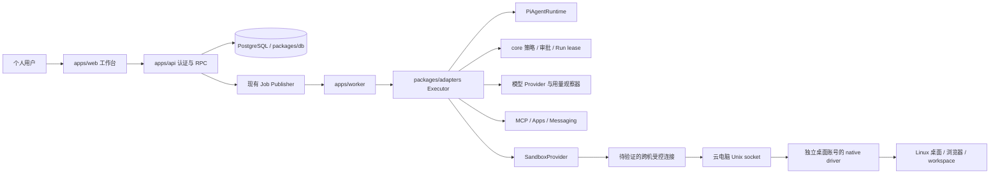
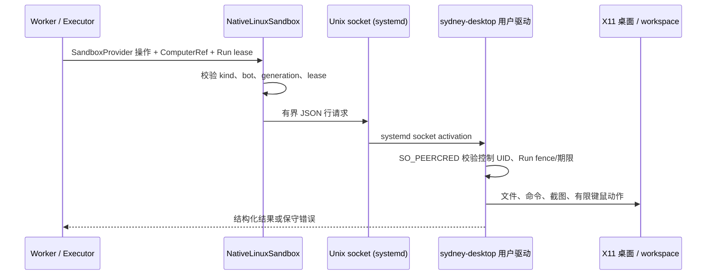

# Sydney 项目架构与设计说明

更新日期：2026-11-04。状态：基于当前源码的架构说明与审计快照；不是生产验收声明。Rakazo 基线为 `aebca9dcfd0cf734484ce41e3c5ad9521551659d`，Sydney 改动直接位于仓库根目录。

本文把已存在的 Rakazo 能力、Sydney 已接线的离线代码和仍待实现/验收的能力分开描述。更细的上游说明见 [架构](architecture.md)、[安全](security.md)、[电脑设计](cloud-computer.md)、[集成](integrations.md) 和 [自托管集成](self-host-integrations.md)；审计结论见 [模块审计](audit/README.md)。

## 1. 定位与首版边界

Sydney 是基于 Rakazo 的个人 Agent 定制项目，不是另起一套 Agent Runtime。当前目标是在后台 Linux 服务器运行 API、Worker、Pi Runtime 和数据库，在独立云电脑运行桌面；桌面通过 `SandboxProvider` 接入，跨机连接仍待实现和验证。项目采用模块化单体和既有 PostgreSQL/Run/Attempt/审批/租约体系，参考 DSH 的任务、派工和 Mandate 思想，不引入 DSH Runtime，也不额外建立调度器或任务数据库。

当前控制链路尚未生产就绪：managed runtime 期间会轮询控制意图并尝试中断，但这不是即时停止，也不能证明后台工作静止；停止确认接口失败关闭，暂停后的恢复及副作用核对不可通过该入口完成。原生 Provider 的租约检查仍需并发与 Linux 验证，详见模块审计。

源码位于根目录：`apps/api`、`apps/worker`、`apps/web`、`packages/contracts`、`packages/core`、`packages/db`、`packages/adapter-kit`、`packages/adapters`。`docx/` 是开发、计划和运维记录目录，不是应用源码目录，也不意味着已有 Word 文件。

## 2. 总体结构

下图描述双机目标；安全转发尚未实现，现有 Provider 只能连接其本机 Unix socket。

API 负责认证用户入口、查询和调度现有 Run；Worker 领取并持有 Run lease/fence，由 Executor 装配上下文并驱动 Pi。`core` 提供无 I/O 策略和投影；`db` 在租户上下文和事务中读写持久状态；`adapter-kit` 定义 Provider 契约；`adapters` 实现模型、工具、连接器和电脑接入。Web 不直接访问数据库或模型。

## 3. 设计思想

- **模块化单体**：首版复用一个 TypeScript 部署和既有队列/数据库，按职责拆包而非提前拆微服务。
- **接口隔离**：模型、存储、Connector、Sandbox 和 Runtime 通过契约隔离，供应商对象不进入任务策略或 UI。
- **策略与执行分开**：纯策略判断许可条件；API 建立可信用户意图；DB 校验租户、版本和 Run；Executor 仍需在模型或工具调用前二次检查。
- **任务、Run、Attempt 分开**：Task 表示用户目标；每次派工创建独立 Run；Worker 每次领取/恢复形成 Attempt，历史不被重试覆盖。
- **最小权限**：Mandate 绑定用户、空间、Bot、Thread、Task、Run、scope 和期限。模型的工具提案不是授权；桌面进程默认不持有后台密钥、数据库权限或 root。
- **未知优先**：超时、掉线、取消失败或历史被截断时保留 unknown/pending，不推断没有副作用、不自动重放不可幂等动作。
- **隔离声明诚实**：Unix 用户分离可隔离部分文件和凭据，但不是 VM/内核边界；Docker 也不能单独替代授权和审计。

## 4. Agent 与 Pi 编排

### 主执行链

1. 用户任务页面通过 `/app/tasks` 认证路由进入；本轮补上了原先缺失的 lazy route 和路由测试（测试尚未运行）。页面流程设计为选择模型数据发送同意、桌面/文件/URL/记忆范围及预算。
2. `tasks.dispatch` 在事务中锁定 Task、检查版本/控制状态/最大 Run 数/期限，创建 `trigger=managed_task` 的 Run 并保存绑定该 Run 的 Mandate。
3. API 将既有 Run continuation job 入队；Worker 用 Run lease 和单调 fence 取得执行权，创建 Attempt。
4. Executor 装配模型、历史、记忆、工具、连接器和电脑上下文，调用 `PiAgentRuntime` 运行模型/工具循环。
5. 模型请求经 `ModelCallObserver` 做调用预算预留和既有用量记录；工具经解析、审批/副作用记录和 managed scope/lease 校验后交给 handler。
6. 完成由 Run 状态与用户可核对的 completion evidence 分开表达；外部副作用未结算、历史读取不完整或缺少完成证据时不显示可靠成功。

### 多 Agent 边界

Rakazo Pi 内置 `run_subagent` 是同一父 Run 中的辅助 Pi 会话，不是独立 Bot、Run、任务队列或安全域。源码限制单层嵌套，最多 4 个并行 helper；helper 使用过滤后的工具集，共享父执行上下文和工具调用预算，并将进展与结果回传父会话。Pi 同时支持单独创建完整 child bot，但那是另一项 Bot 管理能力。

任务历史投影以持久化的 currentRunId 查找当前执行，不依赖历史数组的最后一行；历史查询按创建时间和 ID 稳定排序并显式报告截断。排队取消的 Run 状态和取消事件在同一事务内写入，提交后的通知只是唤醒提示，停止证据仍需独立建立。上述路径尚未经过真实数据库与队列验收。

原生 Linux 工作区文件请求采用两层准入：TypeScript Provider 在数据库侧检查 Run lease，Python driver 在 socket 请求侧再次检查短期限和 fence。该设计减少绕过 Provider 的风险，但不替代 Linux UID、systemd、桌面用户和进程归属的实机验证。

受管 Run 在获取执行租约并创建 Attempt 后启动控制轮询，准备阶段和 Pi 运行期间共享中止信号。停止意图、截止或控制读取异常会阻止后续可检查的步骤；这不证明已发送的操作或后台进程已经停止，服务端静止证明仍待实现和验证。

Sydney managed task 在模型工具列表中只暴露已授权且受支持的工具，不暴露 `run_subagent`、`spawn_bot`、`paid_request` 及尚无等价门禁的 `ask_user`/接管直通分支。普通 Rakazo Run 不使用这一筛选。因此“Rakazo 有 Pi 多 Agent”不等于“managed task 已支持递归/并行子 Agent”。若未来开放，必须为 helper 模型调用计费、共享总 token/deadline、工具权限继承、取消传播和审计增加显式契约。

原生 Provider 现为支持视觉的模型声明截图和图形操作能力，驱动支持截图、点击、键盘、剪贴板粘贴输入和滚动；原生浏览器结构化页面工具、实时流及接管仍关闭。原生终端使用有时限的直接 Bash 命令，以上接线未经过真实 Linux、模型或双机验证。

### 预算解释

Task 保存 `maxRuns`、`maxToolCalls`、`maxModelCalls`、`maxReservedTokens` 和 `timeoutMs`。当前 model guard 以输入 token 估计加最大输出 token 做预留；普通工具独立计数；真实 usage 继续走 Rakazo 用量记录。预留是保守上限，不是账单；不因未知 usage 退款。当前 audit 发现 Pi helper 与部分辅助审核模型没有被 managed task 的 reservation wrapper 明确覆盖，须在开放此功能前补测/修复。未完成线上 token、缓存、价格或 CPU/内存成本测量。

## 5. 云电脑与 Linux 原生桌面

以下时序描述现有驱动的本机调用，不代表跨机连接已实现；双机方案及验收见 [ADR-0008](adr/0008-separate-control-and-desktop-hosts.md)。

### Provider 路径

Provider 通过 `SANDBOX_PROVIDER=native-linux` 和 `SYDNEY_NATIVE_DRIVER_SOCKET` 配置；systemd 单元由 `infra/native-linux/` 提供草案。Executor 为 Run 提供 owner、fence 和数据库租约检查回调；Provider 动作前校验 Run，以及存在时的共享电脑租约，签发期限受数据库期限和八秒上限约束的驱动请求。驱动检查 socket 对端 UID、Bot/generation、短时 Run lease/fence，并限制 workspace 路径、文件大小、命令时长和输出大小。桌面预览只读且按 Bot 身份绑定，可以无 Run lease。该机制尚未通过 Provider/Executor 集成测试，读取后到动作之间仍有竞态，也没有即时中断能力。

### 当前能力限制

已有代码路径包括有限命令执行、文件 list/read/write、单次桌面截图及有限鼠标键盘动作。`connectScreen`、workspace export、snapshot 明确不支持；PTY capability 已设为不可用。`stop`/`destroy` 本轮改为明确报 unsupported；driver cancel/inspect 现已接线，但 inspect 只能确认 active 或 unknown，不能证明 idle，且均未在 Linux 验证。屏幕流、Viewer、人工接管、可靠后台进程静止证明、独立强沙箱均未实现或未验收。

云电脑桌面账号是可控执行账户。其 shell 可访问该账号权限内的文件和网络；被执行的恶意程序可能影响同 UID 桌面及驱动。独立主机改善控制面分离，但网络隔离、凭据保护和可信急停仍须单独实现和验证。

## 6. App 与服务连通方式

“App 连通”不是单一机制。具体可用目录依部署配置、用户连接和凭据而变化，不能把上游所有 connector 宣称为 Sydney 已启用。

| 路径 | 作用及数据流 | 主要边界 |
| --- | --- | --- |
| 直接 Connector / App catalog | API 与 Worker 通过连接器适配层发现工具并调用已连接账号；OAuth/授权材料经现有加密凭据存储解析给服务端，不交给桌面 | 连接器、账号、space/bot 分配和调用工具仍走既有审批及审计 |
| MCP Remote | Worker/API 通过 HTTPS 调用 MCP 服务；支持 OAuth 的服务走授权回调，token 存服务端 | 默认限制公共 HTTPS；私网端点需运维显式允许并防 SSRF |
| MCP stdio | 服务端在 allowlist 命令内启动本地 MCP 子进程，通过 stdin/stdout 交互；OAuth 流由 Rakazo 托管后注入进程环境/私密临时文件 | 子进程具有 API/Worker 运行账号权限，需命令 allowlist、管理员配置和超时 |
| Composio / Pipedream | 外部托管集成平台代理 App 授权与动作，Rakazo 通过其服务端适配器调用 | 需要平台凭据，连接器清单和支持情况以部署配置为准 |
| OpenAPI / GraphQL / 自定义工具网关 | 根据 API schema 生成/解析工具调用，服务端向 HTTPS endpoint 发请求 | schema 不是授权；参数、目标 URL、凭据和副作用仍须门禁 |
| Messaging webhook / outbound | Slack、Telegram、WhatsApp、Feishu/Lark、iMessage/SMS 等按配置接收签名事件并经 Worker 创建 Run、发消息 | 属于消息入口/投递，不等同于模型可调用的 App connector |
| 浏览器 / web tools | 浏览器在电脑内打开页面；`web_fetch` 由服务端访问指定 HTTPS URL | 是网页访问 fallback，不等同于 Gmail/Notion 等有结构化 API 权限的 Connector |

外部服务响应、页面、MCP 工具描述和 API schema 都是数据，不得扩张用户授权。OAuth token、App 密钥、模型密钥和控制面凭据不下发到桌面。首个生产 App 仍待用户选定和联调。

## 7. 数据流、权限与失败处理

- 输入先进入认证 API，并按用户/space 查询；DB 依赖 tenant context/RLS 与显式归属条件。
- Run 执行通过 owner/fence 进行并发所有权；新 fence 使旧 Worker 的后续写入/动作检查失效。
- 每个工具先解析成规范调用并经过既有审批/副作用记录，managed task 再验证精确 grant、控制状态和预算。
- 外部模型只接收本次任务请求、必要历史/记忆和工具结果；页面显式同意目前是一个总开关，不是逐字段脱敏/数据发送预览。
- 外部动作先核对结果，副作用状态为 intended/pending/unknown 时不得当作已完成。
- 取消/暂停是控制意图，不等于正在运行的模型请求、桌面命令或外部请求已被中断。本轮模块审计将此列为阻塞风险。

## 8. 部署与资源

目标是专属 Linux 服务器原生运行服务，不以 Docker 作为首版前提；是否后台运行和运行在哪台机器是两个独立选择。Docker 是可选的进程/文件系统封装，不是云电脑本身；Linux 桌面只有在选容器化 Provider 时才必然装入容器。当前 systemd、socket UID、图形、浏览器 sandbox、反向代理、代理出站和资源限额均待目标服务器验收。

最低规格暂不能由源码可靠给出：内存和 CPU 会受 PostgreSQL、浏览器、桌面分辨率/并发、Pi 上下文、模型代理和后台服务影响。首轮个人单任务应先在授权服务器测 idle/任务峰值 RSS、CPU、磁盘增长和 token 用量，再确定规格；云端模型不要求本机 GPU。尚未形成经过测量的“最低配置”承诺。

安装、升级、备份、恢复和回滚的执行顺序与未验证状态见 [运维手册](../docx/OPERATIONS.md)。当前不提供未经服务器验证的可直接复制部署命令。

## 9. 能力状态摘要

| 能力 | 当前结论 |
| --- | --- |
| Rakazo Pi 主执行链与常规 Connector | 上游源码已有；Sydney 未做全量生产验收 |
| Task / Run / Attempt、Mandate 与工具/主模型门禁 | Sydney 代码已离线接线；PostgreSQL、并发及全入口审计待验 |
| 工作台与任务 API | API 与 `/app/tasks` 路由代码已挂载；路由测试、浏览器 E2E 和真实任务待验 |
| 原生 Linux Provider/驱动草案 | 代码已存在；服务器权限、桌面和清理验收待验 |
| Pi helper 多 Agent | 上游有单层 helper；managed task 当前禁止 |
| OAuth / MCP / 集成服务 | Rakazo 具备多种路径；本地部署启用项和首个真实 App 未确认 |
| 暂停/取消、接管和恢复闭环 | 不满足可生产声明，见模块审计的阻塞项 |

下一步不是盲目扩展多 Agent 或 Connector 数量，而是先补齐执行取消/静止确认、模型预算覆盖范围和 Provider 生命周期契约，再在授权 Linux + PostgreSQL + 选定模型/App 环境完成阶段验收。
