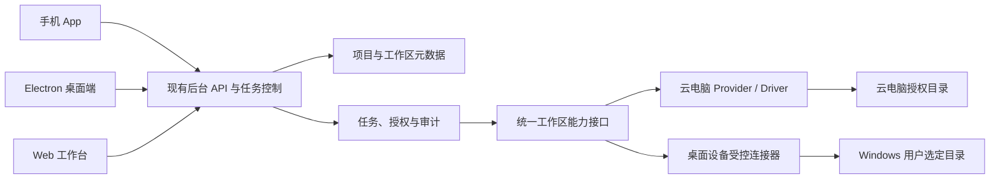

# 项目与工作区接入方案

状态：建议方案，待实施；不代表功能已经上线。  
更新日期：2026-11-10。  
关联需求：PA-004、PA-010、PA-015、PA-017、PA-021、PA-022。

## 1. 目标与范围

为 Sydney 增加「项目」入口，让用户围绕同一个项目查看会话、任务、工作区和产物，并让已授权的 Bot 在选定的工作区内处理任务。项目可以绑定云电脑上的目录、未来 Windows 桌面端选择的本地目录，后续可扩展到 Git 仓库或其他远端主机。

本方案中的「项目」是组织入口，不等同于一个文件夹，也不自动复制、同步或合并不同位置的文件。同一项目可以有多个工作区，每次执行明确选择其中一个；若只有一个可用工作区，可在界面显示默认选择，但仍在任务中固定其身份。

用户补充：以「文件夹工作区」作为日常切换单位。每个已添加的文件夹拥有独立的 Bot、群聊及其聊天；切换文件夹后只显示该文件夹下创建的 Bot 和群聊。同一项目如果绑定多个文件夹，它们仍各自隔离，不能因同属项目就自动共享 Bot 或群聊。

已知基线：仓库存在 Electron 桌面客户端、Web、iPhone 客户端、任务及云电脑相关代码；它们的具体生产部署、权限和完整联调状态仍需逐项核对。项目管理、本地文件接入和本方案所述连接器均为待实现能力，不能从已有 Electron 或云电脑代码推断已经可用。

## 2. 用户体验

### 2.1 创建与进入

- 现有原生首页底部 `InboxQuickActions` 已有连接应用的玻璃按钮和安全区内边距，可作为入口样式及布局参照；首页还用于宽屏分栏，独立项目页面需同时定义分栏与全屏行为。当前尚未添加项目入口或页面，待服务端隔离接口确定后接线。
- 首页屏幕最下方提供「项目」入口组件，沿用应用现有的玻璃组件样式；布局需避开底部安全区，不遮挡列表内容或其他操作。旧系统按既有玻璃组件回退方式显示。
- 该入口首先面向现有手机软件；桌面端在复用 Web 工作台布局的基础上提供对应「项目」入口和独立项目界面，桌面端也能切换、管理文件夹及创建文件夹内的 Bot 和群聊。具体桌面入口位置随现有导航布局确定，不要求将手机底部布局机械搬到桌面。
- 点击「项目」进入独立页面，展示已添加文件夹、名称、位置、当前选中项和连接状态，并提供添加、切换、管理和移除入口。
- 创建项目时先填写名称，可选择绑定一个工作区，也可稍后绑定；不要求 Git 仓库。
- 桌面端可通过系统文件夹选择器选择本机目录；云电脑目录通过已授权的云电脑连接和目录选择能力接入，不让用户误以为它在自己的 Windows 电脑上。
- 进入一个文件夹后，在独立页面展示该文件夹的 Bot、群聊和相关对话，并可在其中添加 Bot、创建群聊及切换文件夹；可逐步增加任务、文件、成果和设置入口。
- 聊天或任务发起时展示实际工作区和执行位置，例如「云电脑：项目 A」或「我的 Windows 电脑：项目 A」。Bot 的授权、任务状态和资源范围继续复用现有体系。

### 2.2 文件夹内的 Bot 与群聊

- 新建 Bot 或群聊时绑定当前文件夹工作区；群聊只能选择当前文件夹中的 Bot。不同文件夹即使创建同名 Bot 或群聊，也应是相互独立的对象。
- 切换文件夹时切换可见的 Bot、群聊和聊天历史；普通首页原有 Bot、群聊及其数据不被删除或自动迁入。记住上次选择时也必须校验用户、设备、空间与工作区仍有效。
- 工作区隔离不能只靠页面筛选。列表、详情、搜索、消息、任务、群成员、附件及 Bot 间调用等服务端入口都必须核对当前用户和工作区；跨文件夹的 ID、旧链接和缓存不能绕过校验。
- Bot 的项目上下文和与文件夹相关的记忆按工作区隔离；是否需要显式跨文件夹分享或复制 Bot 作为后续功能，首期不自动共享。账户级模型设置和授权的继承规则要在实现前明确，不假定所有设置都隔离。
- 任务创建时固定工作区和执行位置。切换文件夹只改变当前界面，不迁移正在执行的任务、接管其他工作区或让任务改在另一个文件夹继续；任务进度仍归属原文件夹。

### 2.3 Bot 识别并处理项目

用户在文件夹中选择 Bot 并描述目标后，Bot 在授权范围内识别项目类型、目录结构、说明文档、已有代码和适用的项目约定，必要时读取相关文件，再规划、实施和反馈结果。项目识别按需、分步进行，不在切换文件夹时默认扫描或上传全部内容。

初始只读接入可完成项目识别、解释和提出修改方案；需要实际修改文件或执行命令时，必须先具备对应工作区的写入或执行能力与有效授权。执行后展示修改摘要、可用的差异与验证结果；未执行的检查、失败和结果未知需如实显示。项目内文件及其内容是待处理数据，不能借其中的文字扩大权限。

### 2.4 连接状态

工作区显示「在线」「离线」「未授权」「连接中」「不可用」等状态，状态由受认证的实际连接及授权决定。选择的桌面设备关闭或休眠后，手机仍可看已保存的项目元数据和历史；不可假装能够读取该设备的最新文件或继续执行本地任务。

重新连接后重新验证设备、会话、工作区身份和权限；不自动重放连接中断前结果未知的写入、命令或 Git 操作。不能将文件列表缓存标成实时状态。

### 2.4.1 手机与桌面协同流程

1. 用户在桌面端登录同一服务和账号，在系统选择器选择本机文件夹并确认授权；设备连接器建立经认证、可撤销的连接。手机端不能替桌面设备自行授权本机路径。
2. 后台保存必要的工作区标识、设备关联、授权状态和会话元数据；手机和桌面在同一账号和有效权限下看到同一个文件夹工作区，以及其中的 Bot、群聊和聊天。具体同步与冲突协议在接口设计时确定。
3. 用户在任一端切换文件夹或发起任务，界面显示选中工作区、所在设备和连接状态；任务固定工作区与执行位置。手机发起读取时经后台转交在线桌面连接器，连接器再次校验目录和操作授权。
4. 桌面离线、授权过期或连接撤销时，两端展示真实状态；已保存的历史和元数据是否可离线读取取决于客户端实际缓存策略，不能承诺实时文件访问或自动续跑。
5. 云电脑目录按相同的工作区与会话归属展示，但读取由对应云电脑受控执行面完成；目录和代码不会因两端看到同一项目而自动复制或同步。

### 2.5 管理与移除

- 项目可以重命名、归档、移除绑定；移除绑定默认只删除关联与相应授权，不删除原始目录。
- 文件夹列表提供删除入口；首期将「删除文件夹」定义为从 Sydney 移除工作区及其关联的文件夹内 Bot、群聊和聊天记录，删除前展示将移除的数据范围，并按产品删除流程处理。**不删除 Windows 或云电脑上的真实目录及文件**。是否提供独立的真实文件删除能力留待后续设计，不把两种删除混为一谈。
- 删除工作区前处理仍在运行或结果未知的任务，停止新的访问、撤销绑定并明确报告当前操作状态；不能声称已中止的进程或外部副作用必然完成回滚。历史任务、成果和备份的保留与清理策略须在落地前明确并在界面展示。
- 删除项目需要明确说明对项目元数据、聊天、任务、缓存和备份的影响；默认不删除工作区真实文件。
- 移动或重命名目录后，通过用户重新选择来恢复绑定；不能单凭同名目录、同一字符串路径或 Git 远端地址认定是原工作区。
- 本地目录授权由用户在该设备上授予、查看和撤销；远程用户或模型提交的路径文本不能代替本机目录选择和授权。

## 3. 接入方式与执行位置

| 方式 | 文件所在位置 | 执行位置 | 首期建议 |
| --- | --- | --- | --- |
| 云电脑目录 | 已接入的专属云电脑 | 对应云电脑授权执行面 | 第一阶段：先做只读浏览与任务绑定 |
| Windows 本地目录 | 安装桌面端的用户电脑 | 用户电脑上的受控执行组件 | 第二阶段：先做目录选择和只读浏览 |
| Git 远程仓库 | Git 托管服务；执行时需有工作副本 | 用户明确选定的本地或云电脑工作区 | 后续：先明确身份、克隆位置和权限 |
| 其他远端主机目录 | 用户授权的其他计算机 | 该主机受控组件 | 后续设计，不直接开放任意 SSH/root |

Git URL 不等于实时文件系统：需将仓库克隆到指定工作区或者绑定已有工作副本。已有的 Windows 本地目录与云电脑目录也不会自动互通。复制或同步作为独立操作，需要显示源、目的、文件范围、大小及冲突策略，用户明确选择后执行。

## 4. 技术架构建议

### 4.1 现有 Space 隔离评估

2026-11-10 独立静态审查结论：优先在既有 Space 内增加文件夹工作区归属，而不为每个目录新建 Space。Space 同时承载成员、电脑、应用连接等较宽边界，并有数量限制；现有跨 Space Bot 通信也可在允许时发生，不能直接作为严格文件夹隔离。此结论是实现方向，不代表数据结构或接口已修改。

普通首页的已有 Bot、群聊和对话保持非文件夹范围，不依目录名自动迁移；空归属不能解释为可访问全部文件夹。请求中的工作区标识必须由服务端结合用户和 Space 重新验证。当前数据库作用域只有用户与 Space，不能单独提供文件夹级隔离。

实施前需逐项梳理并覆盖 Bot 和跨 Bot 通信、群成员、Thread 和消息、长连接、任务和 Run、搜索、附件、记忆、定时任务及后台作业；关联对象必须属于相同的工作区。任务创建时固定工作区与执行位置，排队、恢复及执行时重新验证授权。删除须阻止新访问、处理在途任务并撤销绑定，不删除真实文件。旧数据兼容、迁移回滚、任务历史保留、数据库一致性和运行中删除的具体事务协议仍待完成设计与验证。

该审查基于源码静态分析，尚未穷举全部入口，不能据此认定隔离已经实现或验证通过。

### 4.2 工作区归属与访问契约草案

本节是 W0 的实施契约草案，尚未启用工作区接口。已有本地元数据模型和迁移草案，但迁移未应用，完整隔离和删除生命周期尚未完成，工作区创建保持关闭。首期每个文件夹工作区属于一个 Space 和创建者，现有 Space 成员资格之外还需通过对应工作区的用户授权。文件夹是稳定的不透明标识；显示名、路径字符串或 Git 地址都不能充当身份。先以用户私有工作区为范围，未来共享时另行设计成员权限，不自动向其他 Space 成员共享。

| 请求或操作 | 服务端必须核验 | 非文件夹范围与拒绝条件 |
| --- | --- | --- |
| 工作区列表、详情、修改及移除 | 已认证用户、当前 Space 成员资格、工作区所属用户和 Space，以及工作区状态 | 缺失、跨用户、跨 Space 或删除中的工作区不得被当作普通首页；错误不得暴露其他用户的数据 |
| 创建、列出或访问 Bot、群聊和线程 | 请求范围与对象持久化的用户、Space、工作区完全一致；在事务中校验所选群成员和目标线程 | 旧数据归属为普通首页；普通首页和任一文件夹不得相互访问或混列 |
| 消息、订阅、附件及搜索 | 从所属线程或受控对象解析归属；列表、详情、下载和持续订阅均核验 | 旧链接、伪造 ID、过期缓存或删除后的订阅不得绕过检查；下载凭据不得越过撤销边界 |
| Bot 间调用、记忆、例程和后台任务 | 用已验证来源对象及目标对象的工作区建立范围，后台作业显式携带不可变归属 | 没有可信归属不能回退到整个 Space；跨工作区行为默认拒绝 |
| 任务创建、排队、运行和恢复 | 在创建时绑定线程、Bot、工作区、执行位置和授权，启动或恢复前重新核验状态与授权 | 切换界面不改变已创建任务；撤销后拒绝新动作，对已发出的动作报告真实结果或未知 |
| 文件读取、写入或执行 | 除用户与工作区归属外，执行面还须核验设备、目录绑定及对应动作授权 | 元数据可见不意味着文件可读；设备离线或授权失效时拒绝访问；首期不开放任意本机 Shell |

普通首页范围须作为明确的独立范围处理，不能将空值当作通配符。旧客户端和旧数据库记录保持普通首页行为，新增工作区数据在所有相关访问路径、后台任务和数据库一致性措施完成之前不得对客户端开放。仅靠新增可空列、前端筛选或一次性查询约束不足以实现这一门禁。

迁移采用向后兼容、分阶段启用：先补充可回滚的数据结构并将旧数据保留在普通首页；更新并验证全部读写和后台入口后，才能允许创建工作区数据。回滚前需停止新建和访问、清点新数据与任务并保存备份；旧版本不理解工作区隔离，不能在已有工作区数据上直接恢复读写。涉及删除及授权撤销的数据库操作需与创建、排队及执行门禁协调；先标记停用并阻止新操作，再处理运行中和结果未知任务，最后清理应用关联。具体事务、锁顺序、恢复和备份保留策略须在实现及数据库集成测试中确认，不能只依据此草案声称安全。

删除链路独立审查确认：Space 删除在取得 claim 后先销毁 Bot 和电脑，再删除数据库记录；账号删除先取消计费并清理资源，之后删除成员和账号。若工作区仍存在，限制外键可能在外部资源已删除之后才阻断最终删除。创建开放前必须在任何外部副作用之前以适当系统权限核查全部相关工作区；Space 检查须包含其他成员，账号检查须包含共享 Space。工作区创建与 Space 删除须共用生命周期锁，账号及成员删除还须有持久化门禁覆盖检查后的并发创建。当前无公开创建入口，这些前置门禁和完整清理均尚未实现；不能以预检查替代撤销、任务处理及真实并发验证。

2026-11-11 生命周期候选协议，尚未实现或验证：账号删除在短事务中取得账号生命周期锁，核验系统权限和全账号工作区，并在发生外部副作用前持久化删除操作及状态；未来工作区创建在同一事务中依次取得账号锁和现有 Space 生命周期锁，再核验账号、Space 与成员状态并插入。涉及多个同类对象时按稳定 ID 排序；统一顺序候选为账号、Space、成员及工作区行，须先审计所有旧路径避免反向加锁。普通 Space 删除沿用现有 Space 锁并核查全部成员；成员移除、组织级级联及认证框架最终用户删除也必须接入等价门禁。Serializable 事务在等待 advisory lock 后的快照和冲突重试不能靠锁存在推定，需真实数据库并发验证。

删除恢复候选：持久记录阶段和操作标识，接管时使用新的 fencing token 并对状态更新及句柄清除做条件约束；只有能确认外部副作用尚未发出时才考虑释放门禁。外部请求超时或结果未知时保留门禁和恢复信息，核查提供方状态及幂等能力后再重试；租约过期和数据库 token 不保证旧外部请求已停止。提交结果未知时先按操作标识核查，最终用户删除后的遗留清理需要可持久恢复的记录。旧 Space claim 与工作区并存时先核查旧 worker 和在途操作，不因超时直接清除。上述为后续设计输入，不代表现有删除流程已具备这些保证。

最小反向验收覆盖同一 Space 中两个文件夹、普通首页、不同用户及不同 Space；包括猜测 ID、群成员跨范围、旧链接、搜索/附件、消息订阅撤销、Bot 间调用、执行排队与切换、删除竞态和旧版客户端访问。还需检查默认授权继承、存储策略和所有系统权限后台作业，遗漏入口时保持功能关闭。

- 后台保存必要的项目元数据、工作区标识、任务关联、授权及审计摘要；不默认镜像全部源代码、Git 凭据或本机绝对路径。模型需要读取文件时，明确告知所选模型和实际发送内容的范围。
- 云电脑工作区复用现有 Provider / Driver 及客体授权，不让界面或 Agent 核心绑定特定供应商。
- 本地工作区由未来桌面端的受控组件访问。该组件可以作为 Electron 主进程能力或独立低权限进程的候选；最终边界需评估后确定，渲染页面、手机和远端模型不能直接取得任意本地文件系统权限。
- 2026-11-10 桌面代码静态核查：已有 Electron 沙箱、主框架来源校验及设备配对基础，未发现目录选择和目录授权实现。目录选择应由主进程调用系统选择器，确认前后复核窗口、来源及可信账号；系统确认明确展示目录、服务器、账号和只读用途。选择器不能接受页面提供的路径；本地记录绑定设备、账号及服务器，页面只接收必要的不透明标识。页面脚本来自远程服务器时，即使来源合法也不等于用户授权。
- 不在后台、普通日志或页面返回完整路径；本机保存仍需核验 Windows ACL。目录选择本身不授予任意读写或命令执行，也不证明链接、重解析点及目录替换安全；未来读取需独立实现和验证，失联或撤销后不可继续访问。以上为接线设计，尚未实现或在 Windows 测试。
- 后台和桌面设备之间采用经认证、可撤销、设备身份绑定的受控通信，优先评估由客户端主动建立的加密连接，不要求用户开放 Windows 入站端口。连接协议、端到端保护、令牌保管、连接器是否独立常驻及更新方式须完成设计和安全评审，不能假定现有客户端已具备此能力。
- 同一个项目跨设备展示元数据，不等于所有设备都能访问工作区。桌面端离线、连接被撤销或权限过期时，该位置标记不可用。
- 首期复用现有 Task / Run、Bot、审批和产物模型；通过适配器引入项目绑定，不新建平行的任务执行体系。实际表结构、迁移、客户端 RPC 和接口与现有源码对照后确定。
- 现有 Space 涉及电脑、应用连接等更宽的边界；按 4.1 的评估结果，在既有 Space 内增加文件夹工作区归属，并在服务端强制隔离，保留普通首页旧数据。

建议的领域概念：

| 概念 | 作用 | 边界 |
| --- | --- | --- |
| Project | 名称、归档状态、成员视图以及关联关系 | 不保存所有文件内容 |
| WorkspaceBinding | 项目、位置类型、设备或电脑身份、显示名及能力 | 指向一个明确的已授权位置 |
| Device | 用户授权的桌面设备及连接状态 | 不用设备名称作为唯一身份 |
| ProjectTaskBinding | 任务、项目、工作区及执行位置 | 任务开始后不随默认工作区变更而切换 |
| WorkspaceGrant | 资源、动作、范围、有效期和撤销状态 | 基于现有授权体系设计，不预先承诺新增数据表 |
| WorkspaceBot / WorkspaceGroup | Bot、群聊所属的文件夹工作区 | 归属由服务端验证；命名仅为逻辑概念，不预设新表 |

## 5. 权限与安全边界

1. 第一次绑定由用户在对应设备或已授权云电脑上选定目录；初始阶段只读，写入和命令执行是分开授予的能力，授权可设置范围和期限并随时撤销。
2. 每次操作在执行面验证当前用户、设备、项目、工作区、任务及有效授权。规范化并校验最终路径，处理 `..`、Windows 盘符大小写、符号链接、目录联接、重解析点及目录替换；执行时还需应对校验与使用之间的竞态，不能只依赖字符串前缀。
3. 不默认读取 SSH 私钥、系统账户凭据、浏览器资料和工作区外文件。对 `.env`、密钥文件及大型二进制等采用默认排除与提示策略，用户需显式授予例外；规则不是证明目录内不存在敏感信息。
4. 不向模型或普通日志输出密钥、完整文件内容和会话令牌；向远程模型发送内容时展示必要的数据边界和供应商。文件、搜索和目录结果设大小、数量与超时上限。
5. 无法证明任意终端命令只访问授权目录。因此本地首期不开通任意 Shell；未来必须在经过验证的操作系统级隔离和受限身份中运行，未达到隔离条件时保持禁用。网络、进程、设备和外部账号权限需另行限定。
6. 文件修改提供差异预览或可核对的变更记录。冲突、未保存编辑、文件被外部修改、无权限、磁盘不足和中途断线必须明确报告；先验证是否可恢复，不能承诺所有写入均可回滚。
7. 仓库提交、推送、删除大量文件、发布和运行依赖安装等操作需要明确且覆盖具体范围的有效授权；不从模型文本、仓库文件或工具输出中推断授权。
8. 会话退出、设备解绑、授权撤销及连接超时后停止新的访问；对已经发出的操作记录实际结果或「结果未知」。权限收回不能假装撤销了已经完成的外部副作用。

## 6. 项目与 Git 行为

- 非 Git 文件夹可以作为项目；是否检测到 Git 只影响展示和可用能力。
- 第一阶段只展示可验证的基本信息，读取状态、分支和变更列表之前先核对 Git 执行与凭据边界；仓库 hooks、过滤器、子模块、LFS、外部链接及路径安全必须考虑。
- 查看变更时区分未提交、已暂存、未跟踪和文件被外部修改；不自动暂存、提交、切换分支、拉取、推送、清理或重置。
- Git 与同步是两个不同能力；不将云端仓库当成同一文件的实时同步服务，也不自动处理冲突。多设备编辑产生冲突时要求用户选择处理方式并保留可核对的状态。
- Git 认证使用所在设备或受控服务的安全凭据机制；不把个人 access token、SSH 私钥复制到项目元数据、手机、普通日志或模型上下文。具体授权及凭据流待设计。

## 7. 分阶段实施与验收

### P0：需求冻结与现状盘点

范围：确认首个工作场景、现有文件/任务能力及部署边界；不更改服务。  
交付：数据流、Bot 与群聊归属和删除规则、Space 复用评估、权限矩阵、接口草案、测试计划及必要 ADR。  
验收：明确控制面、云电脑、Windows 与模型各自可访问的数据；区分建议和已实现。

### P1：项目入口与云电脑只读工作区

依赖：现有账号、任务和已授权云电脑文件能力；若能力不足，先完成受控接口。  
交付：屏幕底部项目入口与独立文件夹页面，添加、切换和移除云电脑文件夹，在文件夹内创建 Bot 与群聊，按目录范围只读识别项目并绑定任务，显示连接状态。  
验收：不同文件夹的 Bot、群聊、聊天和任务相互隔离，群成员不得跨文件夹；普通首页原有数据保持可用；切换期间正在运行的任务保持原归属；删除工作区不删除实际目录；只读授权、目录越界拒绝、离线与断线提示及手机/桌面端显示正确；文件写入与执行保持关闭。

### P2：Windows 本地目录只读接入

依赖：已验收的 Electron 登录、设备身份和受控通信。  
交付：本机目录选择、设备绑定和撤销、只读列表/预览、手机查看在线状态。  
验收：同机 Windows 与手机联调；设备休眠/断网时不可访问；跨设备、跨账号和目录联接越界被拒绝；撤销后旧连接与排队操作失效。首期不要求在桌面软件关闭后仍能工作。

### P3：文件修改与项目任务

依赖：工作区授权和可靠的执行隔离。  
交付：Bot 按任务识别项目上下文并在有效授权内实施修改，提供受限文件变更、内容差异和结果记录、项目任务进度、可验证的冲突提示。  
验收：外部编辑冲突、重复请求、断线、撤销、磁盘不足及结果未知均有明确处理；不得借终端越权。

### P4：Git 与多位置协作

依赖：真实使用场景、Git 安全与认证设计、复制/同步方案。  
交付：仓库状态、明确选择的克隆/拉取，以及按需的分支与变更管理；推送等副作用按授权执行。  
验收：非 Git 文件夹兼容，未提交文件保护、冲突处理、认证失败、无网络和用户取消均可核对；同步范围明确。

### P5：桌面本地受限执行

依赖：经过验证的 Windows 隔离方案、操作系统兼容性与具体用户授权。  
交付：授权工作区内的受限工具执行、进度、取消、日志摘要和文件变更记录。  
验收：常见越界、网络绕过、进程残留、休眠重连和授权撤销测试通过；达不到隔离要求则不提供本地任意命令。

每阶段同步总计划、开发记录、验证记录和受影响运维文档。必要时增加 ADR；项目接口、权限、数据路径或部署方式未确定之前不安装新依赖、不修改生产服务。

### 7.1 模块交接与集成门禁

| 模块 | 可交付内容 | 关键前置与验收 |
| --- | --- | --- |
| 服务端隔离与生命周期 | 工作区归属、Bot/群聊/线程及后台任务的读写校验，安全移除与兼容迁移 | 全部访问路径和删除并发门禁完成、真实数据库负向验证后才开放创建 |
| 手机项目界面 | 首页底部入口、独立文件夹界面、切换与管理、当前文件夹内 Bot 和群聊 | 接入已验收接口，验证安全区、离线提示及切换后的数据隔离 |
| 桌面项目界面 | 基于 Web 工作台的入口与独立项目界面，支持相同的工作区和会话操作 | 与手机共享后台归属，不另建一套独立数据；验证窄窗口及现有 Web 回归 |
| 云电脑与桌面连接器 | 云电脑目录和 Windows 本机目录的选择、绑定、只读访问与撤销 | 本机由系统选择器授权；设备认证、越界、断连和撤销通过真实环境验证 |
| Bot 项目任务 | 按工作区读取上下文、固定执行位置、按授权实施修改并反馈 | 先只读，写入和执行分别满足授权及隔离条件后开放；切换不迁移任务 |
| 联调、审核与交付 | 整合手机、后台、云电脑与桌面；记录审核、修复、构建与实机证据 | 独立记录桌面构建、安装、账号联调、手机实机和安全验收，不能互相替代 |

各模块的执行者和实际写集由总调度在 `docx/WORKSTREAMS.md` 登记；仅列出模块不代表已经创建对话或派发工作。共享接口和数据库归属先确定，客户端可在稳定契约下分工，最终由总调度集成、审核并记录未完成项。

## 8. 费用与待决定事项

优先复用现有代码、服务器和本地免费能力，不预设需要购买服务。现有服务器资源、网络流量、模型调用及将来第三方 Git/云服务可能产生费用，具体取决于用户实际选择；不承诺全部使用场景零成本。

待后续实施前按首个场景决定：首要工作区是云电脑还是 Windows；项目绑定是否允许多个工作区；哪些文件可发送给模型；是否需要真正的跨设备同步；Git 托管平台；本地组件是否需要后台常驻。这些选项先保留为设计问题，当前不创建账号、不迁移文件、不授权外部访问。
