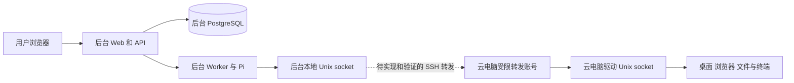

# 后台与云电脑双机方案

2026-11-04 更新：单人使用 SSH 隧道已部署并通过跨机截图、状态及无租约拒绝检查；为此允许专用账号本地 TCP 转发，权限及未验收项见 [ADR-0010](../../docs/adr/0010-personal-trial-ssh-forwarding.md) 与 [V-026](../VALIDATION.md#v-026单人使用双机隧道)。下文保留原设计和实施清单，后台应用和真实任务仍未完成。

状态：设计与实施计划，尚未部署或验收。关联 PA-004、PA-005、PA-006、PA-009 至 PA-018；部署决策见 [ADR-0008](../../docs/adr/0008-separate-control-and-desktop-hosts.md)。阶段状态以 [总计划](../PLAN.md) 为准。

## 目标与现状

当前控制面仍按后台机承载 API、Worker、Pi、PostgreSQL、模型连接及授权审计，云电脑承载 Linux 桌面、浏览器、工作区、Web 和受限驱动。用户新增后期方向：云电脑还将承载 PC 后台，负责渲染产物、PC 专用 BFF 和屏幕代理；主后台数据库、任务控制、模型凭据和审计不迁移。该方向仍处于规划阶段，详见 [ADR-0015](../../docs/adr/0015-pc-backend-on-cloud-computer.md)。

现有 `native-linux` Provider 调用本地 Unix socket；Python 驱动检查云电脑本机 peer UID、Run fence 和短期期限。现有 systemd 示例按同机设计，不能直接视为跨机部署方案。2 GiB 后台先作为测试起点；应用与数据库的峰值、构建、备份和其他服务需实测，资源不足时再调整。

## 候选连接

优先评估 SSH socket 转发，以复用当前协议；网络路径、SSH 可用性及受限身份必须在两台机器上核验。云电脑驱动的 peer UID 是远端转发进程的本机 UID；不能沿用后台用户 UID 数字作身份假设。为驱动访问建立最小权限的专用身份，固定 SSH 主机密钥，使用专用密钥，限制转发目标、交互与权限，并测试权限配置确实生效。密钥、主机地址、订阅及配置秘密不写入仓库。驱动 socket 不直接暴露公网；屏幕预览和后续桌面流必须经过认证与访问控制。

## 实施顺序

1. **环境盘点**：只读确认两机操作系统、CPU/内存/磁盘余量、网络和时间同步、既有服务、代理及部署用户；确认安装、端口、数据目录和资源使用范围。当前机器和仓库版本分别记录，不将桌面已安装当作应用已部署。
2. **连接契约与权限**：梳理 socket 所有者、实际转发端 peer UID、连接凭据、主机密钥、进程管理和路径权限；设计服务器重启、断线重连、主机密钥变更与撤权机制。验证桌面账号无法读取后台密钥或数据库，也不能绕过授权访问控制面。
3. **适配与离线验证**：实现必要的隧道管理及配置，保留现有 Provider 接口和普通 Run 行为。测试连接失败、超时、断开、重连、generation 变化、租约过期、时钟偏差和运行中取消；无法确定操作结果时保持 unknown，不自动重放。
4. **双机系统验证**：在授权服务器上核对 socket 权限与 UID、进程归属、证书或密钥撤销、两机重启、网络隔离、备份恢复和升级回滚。实时流、接管与可信停止证据未实现前保持关闭或明确不可用。
5. **首个闭环**：用户选定模型、授权范围和公开 HTTPS 页面后，从工作台发起摘要任务，核对代理、截图/文件、结果下载、操作记录与实际模型用量，测量两机资源。仅在闭环通过后评估首个真实 App。

## 运行边界和未决事项

- 后台机器如果承载 PostgreSQL，不对云电脑开放数据库管理或信任认证；按现有应用权限限制访问。
- SSH 隧道断开不证明远端进程已停止。驱动故障、桌面操作部分执行、请求超时和网络分区均可能留下未知副作用；不得据此自动重试或开放恢复。
- 短期租约依赖双方时钟及网络延迟；要在实机测量偏差和超时，不仅凭本机时钟检查就声称即时撤权。
- 桌面同 UID 的程序仍可能影响桌面或驱动；跨机隔离也不能替代网络隔离或供应商管理面保护。
- 尚未确定后台和云电脑是否处于同一内网、SSH 转发权限与目标账号、模型及代理配置、磁盘/备份策略。不得将未测命令写成已验证运维步骤。
